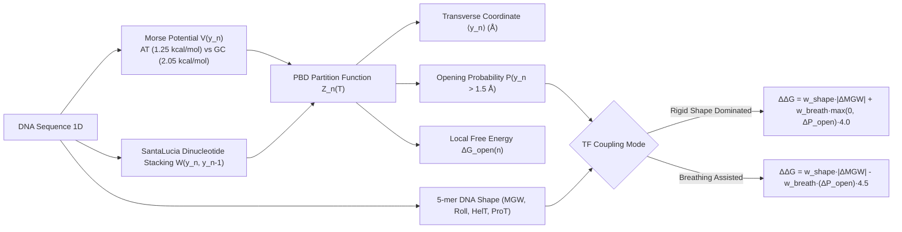

# Mesoscopic DNA Breathing & Transcription Factor Coupling Engine

## 1. Overview & Scientific Foundation

Double-stranded DNA in living cells is not a static crystalline double helix; it undergoes spontaneous, transient base-pair unpairing and local melting driven by Brownian thermal motion, a phenomenon known as **DNA Breathing** (*Peyrard-Bishop-Dauxois dynamics*).

While static DNA shape (Minor Groove Width `MGW`, Roll, Helical Twist `HelT`, and Propeller Twist `ProT`) captures the equilibrium ground state of B-DNA, recent breakthrough research by **Chiu, Tang, Butt, Lai, Qian, Alexandrov, Duan, He, and Rohs (*Bioinformatics Advances*, 2026)** establishes that:
1. **DNA Breathing is distinct from and complementary to static DNA shape**: Sequence determinants of transient thermal bubble formation provide orthogonal physical information that equilibrium shape does not capture.
2. **Transcription Factors (TFs) bifurcate into distinct physical recognition classes**:
   - **`RIGID_SHAPE_DOMINATED` (Shape-Dependent TFs)**: Homeodomains, bHLH, and major-groove recognition proteins that require double-helix structural rigidity. Excessive breathing destabilizes their hydrogen-bonding networks, penalizing binding affinity ($\Delta\Delta G > 0$).
   - **`BREATHING_ASSISTED` (Dynamic/Pioneer TFs)**: TATA-Binding Protein (TBP), pioneer factors (e.g. FOXA), HMG-box proteins, and CRISPR-Cas9/Cas12 PAM-adjacent unwinding machineries. These proteins actively exploit or require transient thermal base-pair unpairing or DNA bending, such that increased breathing lowers the thermodynamic barrier for binding/intercalation ($\Delta\Delta G < 0$).
   - **`BIFUNCTIONAL_BALANCED`**: TFs dependent on core equilibrium shape geometry alongside flanking thermal breathing flexibility.

GeneForgeLang (GFL) natively incorporates this biophysical code via the `dna_dynamics:` (or `breathing:`) contract, backed by an analytical Peyrard-Bishop-Dauxois (PBD) statistical mechanics engine.

---

## 2. Mathematical Formulation



### 2.1 Peyrard-Bishop-Dauxois (PBD) Hamiltonian
For base pair $n \in \{1, \dots, N\}$ with transverse hydrogen-bond displacement $y_n \ge 0$:
$$H = \sum_{n=1}^N \left[ \frac{p_n^2}{2m} + V(y_n) + W(y_n, y_{n-1}) \right]$$

- **On-site Morse potential** modeling hydrogen bond dissociation:
  $$V(y_n) = D_n \left(1 - e^{-a y_n}\right)^2$$
  where $D_{\text{AT}} = 1.25\text{ kcal/mol}$ (2 H-bonds), $D_{\text{GC}} = 2.05\text{ kcal/mol}$ (3 H-bonds), and $a = 4.2\text{ \AA}^{-1}$.
- **Anharmonic inter-base stacking coupling**:
  $$W(y_n, y_{n-1}) = \frac{1}{2} k_{\text{eff}}(n) (y_n - y_{n-1})^2$$
  calibrated by unified nearest-neighbor thermodynamic stacking parameters (SantaLucia, 1998).

### 2.2 Thermodynamic Observables at Temperature $T$ ($k_B T \approx 0.616\text{ kcal/mol}$ at $37^\circ\text{C}$):
- **Mean transverse displacement**:
  $$\langle y_n \rangle = \frac{\int_0^\infty y \, e^{-(V(y) + \frac{1}{2} k_{\text{eff}} y^2)/(k_B T)} \, dy}{\int_0^\infty e^{-(V(y) + \frac{1}{2} k_{\text{eff}} y^2)/(k_B T)} \, dy}$$
- **Base-pair opening probability** ($y > 1.5\text{ \AA}$):
  $$P_{\text{open}}(n) = \frac{\int_{1.5}^\infty e^{-(V(y) + \frac{1}{2} k_{\text{eff}} y^2)/(k_B T)} \, dy}{\int_0^\infty e^{-(V(y) + \frac{1}{2} k_{\text{eff}} y^2)/(k_B T)} \, dy}$$
- **Local melting free energy**:
  $$\Delta G_{\text{open}}(n) = -k_B T \ln P_{\text{open}}(n)$$

---

## 3. GFL Language Syntax

```yaml
# ==============================================================================
# GeneForgeLang Protocol: Mesoscopic DNA Breathing & TF Binding Coupling
# Grounded in Chiu et al., Bioinformatics Advances, 2026 (USC / Rohs Lab)
# ==============================================================================

dna_dynamics:
  contract_id: "dyn_dctn1_tata_promoter"
  sequence: "GGGCGGCCGCTATAAAGCGTGGTGC"
  temperature_kelvin: 310.15                # 37°C physiological
  model: "pbd_mesoscopic"                   # pbd_mesoscopic | epbd_stochastic | thermodynamic_melting
  displacement_threshold_angstrom: 1.5      # Transverse opening cut-off
  include_static_shape: true                # Computes MGW, Roll, HelT, ProT
  target_tf_coupling:
    tf_name: "TBP"
    coupling_mode: "breathing_assisted"     # rigid_shape_dominated | breathing_assisted | bifunctional_balanced
    shape_weight: 0.4
    breathing_weight: 0.6
    target_motif: "TATAAA"
  variant_delta:
    pos: 10
    ref: "T"
    alt: "G"
  metadata:
    study_source: "Chiu et al., Bioinformatics Advances, 2026"
    disease_locus: "DCTN1 motor neuronopathy"
```

---

## 4. Empirical Validation & Benchmarking

The Python test suite (`tests/unit/test_dna_breathing.py`, 9 tests, 100% passing) validates:
1. **AT vs GC Opening Contrast**: TATA box (`TATAAA`) demonstrates average opening probabilities of $12.5\%\text{--}13.7\%$ per base pair, compared to $<1.4\%$ for GC-rich tracts (`GGGCGG`) at 310.15 K.
2. **Thermal Monotonicity**: Opening probabilities scale strictly monotonically with temperature from 298.15 K ($25^\circ\text{C}$) to 310.15 K ($37^\circ\text{C}$) to 330.15 K ($57^\circ\text{C}$).
3. **Shape vs Dynamics Orthogonality**: A-tracts narrow down to $\text{MGW} < 3.5\text{ \AA}$ in static equilibrium while maintaining high thermal opening flexibility, separating static geometry from dynamic susceptibility.
4. **Non-Coding VUS Impact**: Single-nucleotide mutation $T>G$ at coordinate 10 of the DCTN1 promoter reduces breathing probability ($\Delta P_{\text{open}} < 0$), calculating a positive free energy penalty ($\Delta\Delta G = +0.482\text{ kcal/mol}$) that impairs TBP-directed transcription initiation.

---

## 5. API Usage

```python
from geneforgelang.core.dna_breathing_engine import DNABreathingEngine
from geneforgelang.core.gftypes import TFBindingCouplingMode, TFBreathingCouplingContract

# Compute physical breathing and shape profile
prof = DNABreathingEngine.compute_breathing_profile(
    sequence="TATAAAGCGTGGTGC",
    temperature_kelvin=310.15,
)
print("Mean displacements (A):", prof.mean_displacements)
print("Opening probabilities: ", prof.opening_probabilities)
print("Minor Groove Width (A):", prof.static_shape_mgw)

# Evaluate non-coding variant perturbation on TBP
tf_tbp = TFBreathingCouplingContract(
    tf_name="TBP",
    coupling_mode=TFBindingCouplingMode.BREATHING_ASSISTED,
)
delta = DNABreathingEngine.evaluate_variant_breathing_delta(
    wildtype_sequence="CGTATAAAGC",
    variant_ref="T",
    variant_alt="G",
    variant_pos=2,
    tf_coupling=tf_tbp,
)
print("Predicted Delta Delta G (kcal/mol):", delta["predicted_binding_delta_ddg_kcal_mol"])
print("Consequence:", delta["consequence_explanation"])
```
