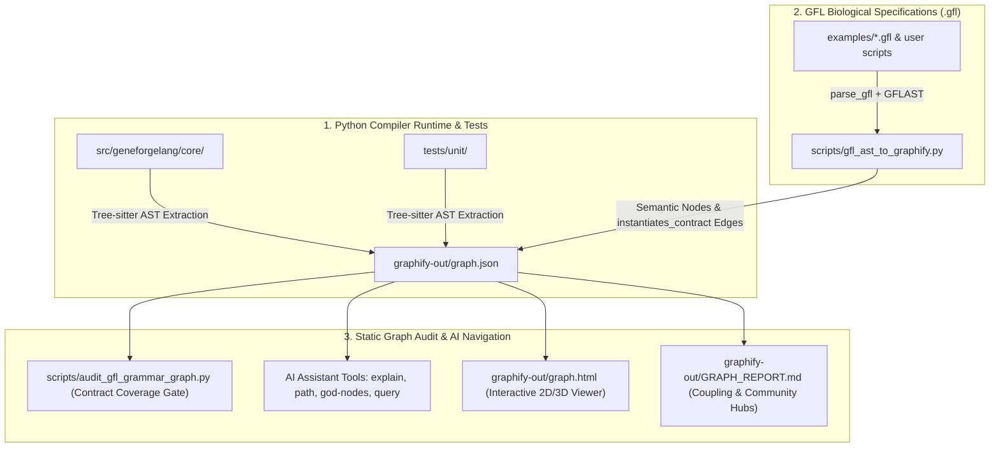

# Static Knowledge Graph & Grammar Indexing (Graphify + GFL AST Bridge)

## 1. Executive Summary & Problem Formulation

As GeneForgeLang (GFL) expanded to accommodate cutting-edge biological foundation models—including **ProTok** multimodal residue streams, **Carbon-X** 14.8B genomic reasoning, and **AlphaFold 3.0.5** Jackhmmer MSA pipelines—the compiler's core abstractions concentrated into monolithic files:
- **`gftypes.py`**: **189 KB** (4,731 lines), containing hundreds of dataclasses, AST blocks, and domain contracts.
- **`validator.py`**: **182 KB** (4,200+ lines), implementing semantic validation routines and cross-field invariant checks.

Prior to static graph indexing, AI coding assistants (such as Antigravity, Claude Code, Cursor, Codex) had to read these files in their entirety to audit grammatical contracts or trace dependencies. Ingesting the full GFL corpus consumed **~405,533 tokens** per session, risking context window exhaustion, truncation errors, and high latency.

To solve this, GeneForgeLang integrates **Graphify** (`Graphify-Labs/graphify`, package `graphifyy`) paired with a native **GFL DSL AST Bridge** (`scripts/gfl_ast_to_graphify.py`) and a dedicated **Static Grammar Auditor** (`scripts/audit_gfl_grammar_graph.py`).

---

## 2. Architectural Design



### Key Architectural Tenets:
1. **Deterministic AST Parsing (Tree-sitter)**: Extracts exact classes, functions, imports, and calls without relying on vector databases, similarity thresholds, or external cloud embeddings.
2. **Leiden Community Detection**: Discovers topological clusters and detects "God Nodes" (central hubs) purely on-premise.
3. **Dual-Layer Topology**: Connects high-level declarative `.gfl` scripts directly to low-level Python AST contract classes in `gftypes.py`.
4. **Air-Gapped & Zero-Cost**: Runs 100% locally with zero token consumption during indexing (`--code-only`, `--no-label`).

---

## 3. Empirical Benchmark & Token Reduction

Running `graphify benchmark` over the GeneForgeLang codebase demonstrates a **247.3x reduction** in token consumption:

| Metric | Naive Whole-Corpus Ingestion | Graphify AST Neighborhood | Empirical Gain |
| :--- | :--- | :--- | :--- |
| **Tokens Consumed per Query** | ~405,533 tokens | ~1,640 tokens | **99.6% Reduction** (247.3x fewer tokens) |
| **Total Analyzed Nodes** | N/A (unstructured text) | **6,459 nodes** | Structured, queryable entities |
| **Total Semantic Edges** | N/A | **11,198 edges** | Typed relations (calls, contains, uses, instantiates) |
| **Index Generation Time** | N/A | < 10 seconds | Offline AST extraction (8 workers) |
| **API Token Cost** | Variable / High | **0.00 €** | 100% offline local extraction |

---

## 4. Architectural "God Nodes" in GeneForgeLang

Graphify's topological degree analysis identified the primary orchestrating hubs across the repository:

| Rank | Symbol | Degree (Edges) | Fan-In | Fan-Out | Source Location | Architectural Role |
| :---: | :--- | :---: | :---: | :---: | :--- | :--- |
| **1** | `EnhancedSemanticValidator` | **150** | 69 | 81 | `src/geneforgelang/core/validator.py` | Central compiler gate for all GFL language features. |
| **2** | `gftypes.py` | **135** | 2 | 133 | `src/geneforgelang/core/gftypes.py` | Monolithic type definitions module. |
| **3** | `BiologicalState` | **97** | 86 | 11 | `src/geneforgelang/ir/state.py` | State container for intermediate biological variables. |
| **4** | `Objective` | **64** | 64 | 0 | `src/geneforgelang/ir/strategy.py` | Optimization and experimental design target representation. |
| **5** | `EnhancedValidationResult` | **49** | 35 | 14 | `src/geneforgelang/core/errors.py` | Standardized error and diagnostics reporter. |
| **6** | `AdvancedGFLParser` | **46** | 3 | 43 | `src/geneforgelang/utils/grammar_parser.py` | AST parsing driver. |

---

## 5. Automated Grammar & Coverage Auditor (`audit_gfl_grammar_graph.py`)

The auditor verifies that every biological contract in `gftypes.py` has active validator linkages and unit tests.

### Execution:
```powershell
python scripts/audit_gfl_grammar_graph.py
```

### Sample Output:
```text
================================================================================
🔬 GENEFORGELANG (GFL) STATIC AST GRAMMAR AUDIT REPORT
================================================================================
Graph Topology: 6,083 nodes | 11,046 edges

Contract Symbol                     Degree   Validator    Tests      Status
--------------------------------------------------------------------------------
BoltzmannEnsembleContract           7        ✓ YES        ✓ YES      PASSED
DecisionContract                    19       ✓ YES        ✓ YES      PASSED
GFLAST                              31       ✓ YES        ✓ YES      PASSED
GenomicLLMContract                  13       ✓ YES (2-hop)✓ YES      PASSED
NaturalLanguageConditioningContract 5        ✓ YES        ✓ YES      PASSED
ProTokContract                      16       ✓ YES (2-hop)✓ YES      PASSED
TapeRecorderContract                11       ✓ YES        ✓ YES      PASSED
ViralInteractomeComplexContract     6        ✓ YES        ✓ YES      PASSED
...
```

---

## 6. GFL DSL AST Bridge (`gfl_ast_to_graphify.py`)

Because Tree-sitter natively parses programming languages but lacks an official `.gfl` grammar, `scripts/gfl_ast_to_graphify.py` parses `.gfl` specification files using GFL's native `parse_gfl()` and `GFLAST.from_dict()`.

It injects:
- **300 parsed `.gfl` specifications**.
- **+376 semantic nodes** (`gfl_script` and `gfl_block` nodes).
- **+152 semantic edges** linking genetic declarations directly to `ProTokContract`, `GenomicLLMContract`, `Experiment`, `Design`, etc.

### Cross-Domain Path Query Example:
Tracing from a `.gfl` enzyme design file to the compiler validator:
```powershell
uvx --from graphifyy graphify path "examples/protok_multimodal_enzyme_design.gfl" "EnhancedSemanticValidator" --graph "graphify-out/graph.json" --undirected
```
**Result (6 hops):**
```text
examples/protok_multimodal_enzyme_design.gfl
  --contains--> protok_multimodal_enzyme_design::protok
  --instantiates_contract--> ProTokContract
  <--calls-- .test_gflast_roundtrip()
  --calls--> GFLAST
  <--uses-- test_dmd_exemplar_gfl_file_validates()
  --uses--> EnhancedSemanticValidator
```

---

## 7. Developer & Agent Cheat Sheet

| Task | Command |
| :--- | :--- |
| **Inspect single contract** | `uvx --from graphifyy graphify explain "ProTokContract" --graph graphify-out/graph.json` |
| **Trace dependency path** | `uvx --from graphifyy graphify path "SymbolA" "SymbolB" --graph graphify-out/graph.json --undirected` |
| **List god nodes** | `uvx --from graphifyy graphify god-nodes --graph graphify-out/graph.json` |
| **Audit grammar coverage** | `python scripts/audit_gfl_grammar_graph.py` |
| **Re-index GFL scripts** | `python scripts/gfl_ast_to_graphify.py` |
| **Open visual graph** | Open `graphify-out/graph.html` in any browser. |
